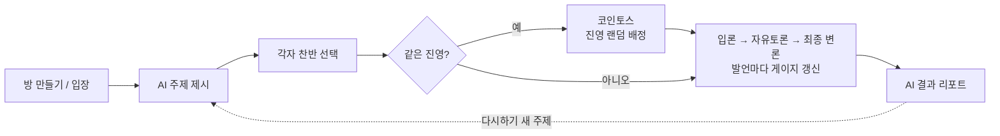

# 토론함뜰래? (Wanna Debate?) 기획서

2026-10-15 · [원본 문서](https://claude.ai/code/artifact/73ef6647-4220-4520-84ae-cac42fd09503)

## 개요

토론함뜰래?(Wanna Debate?)는 두 플레이어가 AI가 낸 주제로 1:1 토론을 하고, AI 심판이 실시간으로 우세를 판정해 주는 웹 게임입니다.

- **컨셉**: 링크 하나로 바로 들어와 10분 안에 한 판을 끝내는 가벼운 토론 대결
- **레퍼런스**: 예스노 탐정, 80억분의1처럼 설치 없이 브라우저에서 플레이하는 AI 기반 웹 게임
- **타깃**: 친구와 내기·말싸움을 즐기는 사람, 토론 연습이 필요한 학생과 취준생
- **재미 포인트**: 내 의견과 반대 진영을 맡을 수도 있는 코인토스, 말 한마디마다 움직이는 게이지, 끝나고 받는 AI 총평

## 게임 흐름

한 판은 약 10분, 방 입장부터 결과 리포트까지 6단계로 진행됩니다.

두 사람이 서로 다른 진영을 고르면 바로 토론으로, 같은 진영을 고르면 코인토스로 한 명을 반대편에 배정합니다.

**토론 진행 (입론 → 자유토론 → 최종 변론)**

1. 입론 (턴제): 찬성 → 반대, 각 90초, 최대 1000자. 시간이 끝나면 쓴 데까지 자동 제출
2. 자유토론 (3분): 둘이 채팅처럼 자유롭게 주고받음. 메시지당 200자, 연속 전송 간격 3초
3. 최종 변론 (턴제): 반대 → 찬성, 각 60초. 입론과 순서를 바꿔 마지막 발언 이점을 나눔

## 핵심 기능

게임의 재미는 실시간 우세 게이지와 끝난 뒤의 결과 리포트 두 가지에서 나옵니다.

### 1. 실시간 우세 게이지

- 화면 상단에 찬성(파랑) vs 반대(빨강) 가로 막대, 예: **찬성 58 : 42 반대**
- 발언이 하나 제출될 때마다 AI가 지금까지의 토론 전체를 다시 보고 비율을 갱신 (합계 100)
- 게이지 아래에 한 줄 코멘트, 예: “반대 측이 통계 근거로 반격해 추격 중”
- 채점 기준: 논리성, 근거의 구체성, 상대 논점에 대한 반박, 주제 일치도 (글 길이나 말투는 점수에 넣지 않음)

### 2. 결과 리포트

토론이 끝나면 AI 심판이 아래 항목을 한 화면에 보여줍니다.

| 항목 | 내용 |
| --- | --- |
| 최종 스코어 | 예: 찬성 62 : 38 반대 |
| 승자 | 닉네임과 진영 (동점이면 무승부) |
| 스코어 근거 | 왜 몇 대 몇이 됐는지, 점수가 크게 움직인 결정적 발언 |
| 승리 이유 | 이긴 쪽이 무엇을 잘했고 진 쪽이 무엇을 놓쳤는지 |
| 찬성 측 핵심 | 찬성 측 핵심 논지 2\~3개 |
| 반대 측 핵심 | 반대 측 핵심 논지 2\~3개 |
| 토론 팁 | 플레이어별 맞춤 팁 + 이 주제에서 쓸 수 있었던 논점 |

결과 화면에는 단계별 게이지 변화 그래프도 함께 보여줍니다.

## 화면 구성

화면은 4개이며, 모바일 세로 화면을 기준으로 만듭니다.

| 화면 | 주요 요소 |
| --- | --- |
| 로비 | 닉네임 입력, 방 만들기, 초대 코드·링크 복사, 코드로 입장 |
| 주제·진영 선택 | AI가 낸 주제와 배경 설명, 찬성/반대 버튼, 상대 선택 대기 표시, 코인토스 애니메이션 |
| 토론 | 상단 우세 게이지 + AI 한 줄 코멘트, 진행 단계(입론·자유토론·최종 변론) 표시, 남은 시간, 채팅형 발언 로그, 입력창 |
| 결과 | 승자 발표, 최종 스코어, 게이지 변화 그래프, 리포트 항목, 다시하기 버튼 |

## 기술 구성

두 사람이 각자 기기에서 접속해야 하므로, 실시간 서버 하나가 방 상태를 들고 AI 호출을 대신합니다.

| 구성 | 기술 | 역할 |
| --- | --- | --- |
| 프론트 | HTML/CSS/JS (웹) | 화면 4개, 게이지·코인토스 애니메이션 |
| 실시간 서버 | Node.js + Socket.IO | 방 생성·입장, 턴 진행, 타이머, 양쪽 화면 동기화 |
| AI | Google Gemini API | 주제 생성, 발언마다 게이지 채점, 최종 리포트 |

AI 호출은 한 판에 약 10번 안팎입니다. 자유토론 중에는 메시지마다가 아니라 몇 개씩 묶어서 채점합니다. 채점은 빨리 나오도록 가벼운 Gemini 모델, 최종 리포트는 더 성능 좋은 모델로 돌리고(정확한 모델은 개발할 때 정함), API 키는 서버에만 둡니다.

## 개발 범위

MVP는 “링크로 두 명이 들어와 한 판 토론하고 리포트를 받는다”까지입니다.

**MVP**

- [ ] 방 만들기·코드로 입장 (2인 전용)
- [ ] AI 주제 생성 + 찬반 선택 + 코인토스
- [ ] 입론 → 자유토론 → 최종 변론 진행 + 단계별 타이머
- [ ] 발언마다 우세 게이지 갱신
- [ ] 최종 결과 리포트 + 다시하기

**이후 확장 아이디어**

- 주제 카테고리 선택 (일상, 사회, 밸런스 게임 등)
- 관전 모드와 관중 투표
- 결과 카드 이미지 공유
- AI 상대와 혼자 연습하는 1인 모드
- 전적·랭낹
